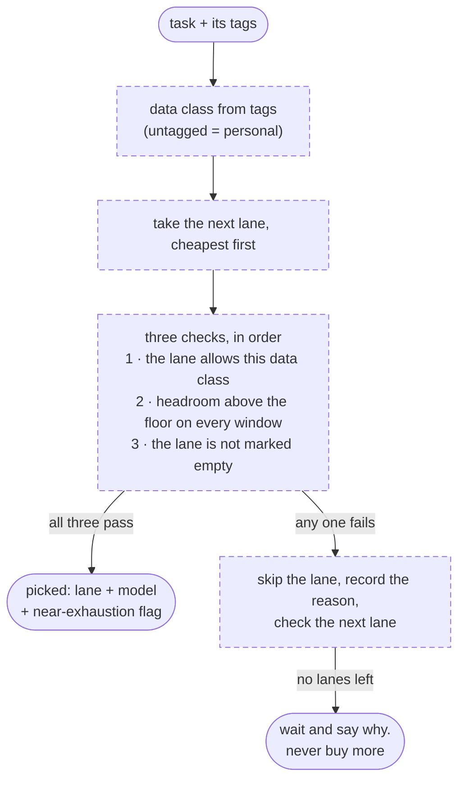
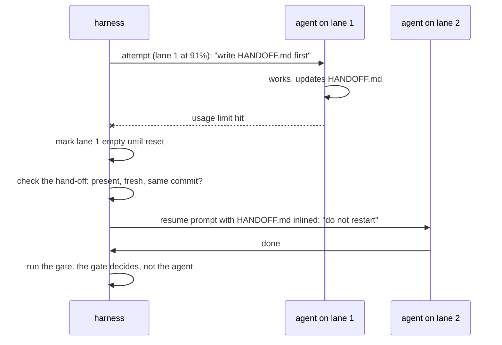

In a Formula 1 or NASCAR race, the fuel still in the tank when the flag drops is worth exactly nothing. Nobody carries it over to next weekend. So the last stint runs the tank dry on purpose, and the person who decides that is not the driver. It's the crew chief on the pit wall, the one staring at gauges instead of the road: who's in which car, which car has fuel, how much race is left. The driver's job is to drive. The crew chief's job is to make sure nobody finds out about the fuel situation at 180 miles an hour.

Parts 2 through 4 covered three decisions Aida makes without asking a model: where to look, what to remember, and what to work on next. This part is the fourth one, and until last week I was making it by hand, several times a day, badly. **Which model should do this job, and on whose tab?**

## The decision I kept getting wrong

I pay for several AI plans at once. Each has its own five-hour window and its own weekly window, each resets on a different day, and each is good at different things. Whatever is unused when a window resets is thrown away, like the fuel. Meanwhile the autonomous loop from [part 4](/posts/aida-part-4-what-it-spawned/) would spawn an agent with whatever model the config named, whether or not that plan had anything left, whether or not the task deserved the expensive model, and whether or not that login was allowed anywhere near the data the task touched.

That last one matters more than it sounds. I have a personal subscription and a company seat. Company work must never run on my personal login, and my personal finances must never run on the company's. That's not a preference, it's a wall, and "the model will probably pick the right one" is not a wall.

Aida could already read the gauges. This is the Models panel on her dashboard, taken a few minutes after the run I'll describe below:


<p style="text-align:center;font-size:0.9em;margin-top:0.5em;"><em>(UI in progress )</em></p>

Every bar is how much of a window is used. The little marker is how far through the window the clock is, so a fill well left of the marker means I'm under pace and that plan is going to expire with fuel in it. Look at the top card: the weekly bar sits at 22 percent with the clock most of the way through. That's 70-odd percent of a week I paid for and was about to hand back.

The gauges were lovely. Nothing read them.

## The week the guidance was visible and ignored

Here's this part's confession, and it's the reason the arbiter exists.

**Symptom:** on September 13th I looked at the panel and my most expensive model, the one with its own small weekly cap that I save for hard thinking, had burned a chunk of its week on code sweeps. Mechanical find-and-fix work. The kind of thing the mid-tier model does faster and just as well.

**Wrong hypothesis:** the guidance must be unclear. I had notes right there in the roster file, in plain English: executors run on the mid-tier model, the big one is for judgement. So I did what everyone does. I made the notes clearer. Bolder. More specific.

**Actual cause:** the notes were perfectly clear. They were also prose, sitting in a file that nothing consulted at the moment an agent was spawned. I had written a sign and hung it in a room no one walked through. The capacity view was *visible*. It was never *asked*.

If that sounds familiar, it should. It's the lesson from [part 2](/posts/aida-part-2-how-it-decides/), again, wearing a different hat: **the model may ignore a hint, but it cannot ignore arithmetic.** I had learned it for routing questions and then failed to apply it to routing work.

**Fix:** stop writing guidance and start writing a gate. That gate is the arbiter. And the first rule it got is the bluntest one in the codebase: no lane may name the big model as its executor. Not "prefer not to." The roster fails to load.

## A lane is a car, a driver, and a set of keys

The arbiter's rulebook is, of course, a YAML file. Each entry is a *lane*: a machine, a runtime, and a credential, cheapest first. Here's one, lightly trimmed from the example that ships in the repo:

```yaml
# ~/.aida/lanes.yaml
lanes:
  - id: claude-personal
    order: 1
    provider: "Anthropic / Claude"       # must match a row in models.yaml
    windows: ["5h", "7d"]
    data_classes: [personal, games, public]
    runner: claude                        # the vendor's own CLI
    auth: subscription
    models:
      executor: claude-sonnet-5
      thinker: claude-opus-5

  - id: claude-company
    order: 2
    provider: "Anthropic / Claude (company seat)"
    data_classes: [company, public]
    runner: claude
    config_dir: "~/.claude-company"
```

Two lines do most of the work. `data_classes:` is an allowlist with no wildcard: a lane accepts only the kinds of work it names, and a new kind has to be added on purpose. And `provider:` ties the lane to a row of live gauges, so "does this lane have fuel" is a lookup, not a guess.

A task gets its data class from its tags. Untagged means personal, on the theory that an unlabeled box should be treated like it might contain something private until proven otherwise. Then the pick is a walk down the list:



Notice what is missing from that diagram: a model. The pick is deterministic, top to bottom, and every lane it skips carries a reason. Which means there's a dry run, and the dry run is the whole user interface. A mixed queue looks like this (lane names from the example roster; mine differ):

```
$ aida arbiter plan --tag project:aida

TASK  CLASS     LANE           MODEL            NEAR-EXHAUSTION  REASON
#512  company   claude-company claude-sonnet-5  no               claude-personal: data class "company" not allowed
#530  personal  claude-personal claude-sonnet-5 yes(91%)         eligible  -> HANDOFF.md armed on this lane
#544  games     codex          gpt-5.6-terra    no               claude-personal: 5-hour headroom 2.0% < min 5.0%
#513  company   none           -                -                claude-company: 7-day headroom 0%; no other lane allows company
```

Read the last row. A company task with nowhere to go does not quietly fall through to my personal login, and it does not reach for a metered API key. It waits, and the table tells me why. The crew chief may *suggest* buying more fuel. Buying it is my call, every time.

> **Techy tidbit:** "Headroom above the floor" is doing real work. `aida burndown capacity` turns the raw gauges into a floor per window: a reserve for my own daytime use, forced to zero when a window resets before morning (leftover fuel is worthless, so drain it), and replaced by a pace-derived floor once there's enough history to project my own usage. The arbiter never probes anything itself, it only reads that view. `internal/burndown/`, `internal/arbiter/pick.go`, and the decisions are written down as ADRs in `docs/adr/`.

## The three decisions that took the longest

The picker was the easy part. The hard part was what happens when reality disagrees with the plan, mid-task, at 2am, with nobody watching. Three decisions, each still being argued when the code started.

**A task that runs a lane dry resumes. It does not restart.** The obvious design is: lane runs out, kill the agent, start a fresh one on the next lane. The fresh one then spends twenty minutes rediscovering what the first one already knew, on a different plan's dime. So when the picked lane is past 90 percent of any window, the harness changes the deal before the attempt begins: write a hand-off note first. The harness pre-fills the header and the acceptance criteria; the model fills in what it did, what it learned, and what's next.



The harness does not trust the note blindly. It checks that the hand-off exists, that it was written during this attempt and against this commit, and that it isn't stale. A bad note gets named in the next prompt and the next agent is told to reconstruct instead.

**An ambiguous rate-limit signal counts as a rate limit.** When a CLI exits strangely, was that the quota wall or just a crash? I spent a while trying to classify that precisely before admitting I couldn't. So it fails open: ambiguous means "treat the lane as empty until its next reset, or an hour," and the task moves on without burning one of its fix attempts. Every one of those marks is logged with an `ambiguous` flag, so if the guess rate gets silly I'll see it. Being wrong in this direction costs me an hour of one lane. Being wrong in the other direction is a loop hammering a dead plan all night.

**Two machines must never work the same task.** I run this on more than one box, and they share a task list through git. The claim had to be atomic without standing up a lock server, because I am not standing up a lock server for a personal project. The answer was already in git: a lease is a ref, `refs/leases/<task>`, pushed with `--force-with-lease`. The remote evaluates that atomically, so six machines racing produce exactly one winner and five rejected pushes. A rejected push *is* the collision signal. The losers back off and pick something else.

> **Techy tidbit:** "Done" is the other thing the model doesn't get to decide. Per-task state lives in a `STATE.json` that only the harness writes, and a task is done when its gate passes: the `--check` commands plus any deliverables named in the task body. An agent announcing DONE in a log is not consulted. There's a test that runs six concurrent claimers against one bare repo and asserts a single lease survives. `internal/taskstate/`, ADR-0001 and ADR-0004.

## The first stint

The scheduler half of this, `aida serve --arbiter`, wakes at 11pm, and also whenever a weekly window is within a day of resetting with fuel still in it. I'd built it, tested it with a fake clock, and never watched it run for real. So tonight I did, and I didn't even have to fake the clock: one of my weekly windows resets tomorrow afternoon, the scheduler looked at the gauges, and said go.

I tagged three small, real tasks from my own backlog, pointed it at them with a build-and-test gate, and took my hands off:

```
🌙 starting arbiter scheduler - tags=[wave1] nightly=23:00 weekly-drain=24h0m0s

=== round 1 ===
  • #298 brain harvest: surface distill failures loudly
  lane=claude-max model=claude-sonnet-5-5 class=personal (headroom 62%)
  running code gate: 1 check(s)
  committed: feat: #298 brain harvest: surface distill failures loudly
```

Three rounds like that. Then the timing sheet:

```
$ aida arbiter ledger
20:21  brain-harvest-surface-distill-failures  claude-max  claude-sonnet-5-5  attempt=1  pass  wall=1m48s
20:23  fix-aida-ask-subagent-timeouts          claude-max  claude-sonnet-5-5  attempt=1  pass  wall=2m3s
20:24  aida-fleet-start-model-is-a-no-op       claude-max  claude-sonnet-5-5  attempt=1  pass  wall=1m19s

3 entries -- by lane: claude-max: 3 -- by verdict: pass: 3
```

Three tasks, three passes on the first attempt, five minutes of agent time. One of them was a seven-file change with new tests. The five-hour gauge went from 8 percent to 9. And every one of them ran on the mid-tier model, on the plan cleared for personal work, because a file said so and a gate enforced it. Somewhere in there my laptop played the hammer sound I use for "an Aida run finished," which was more fun than it had any right to be.

Now the honest part, because a first real run is a bug report you didn't have to write. It found four things:

1. One task logged "commit failed" and got parked. Nothing had failed. The agent had already committed its own work, so the harness had nothing left to commit and treated an empty commit as an error.
2. After the three tasks finished, the wave just sat there marked "running." It was waiting for its window to close before writing its summary, and the window had eighteen hours left. I got my summary by stopping the daemon.
3. The dashboard card showed the next wake time as December 31st of the year 1, which is what a zero-valued timestamp looks like when you forget it can be zero.
4. The subtle one: the window that *woke* the scheduler was one plan's, and the lane that did the work was another's. Cheapest-first picked lane 1 as designed, so the plan that was about to expire didn't get drained at all. The crew chief saw the right flag and sent out the wrong car.

None of these lost work, all four are filed, and I'd take four boring bugs with a ledger over one mysterious night without one. That's the same trade as the rest of this series: when the middle is deterministic, even the failures leave a paper trail.

## What the crew chief never does

It's worth being exact about where this thing's authority ends, because the ending is the design.

It never spends new money. When every allowed lane is dry it waits and tells me why. It never lets company work touch a personal login or the reverse, and "never" there is a load-time error, not a tendency. It never promotes a task to the expensive model because the task sounded important. And it never decides a task is finished.

It decides who drives which car, hands over the sheet, and watches the gauges. That's the whole job.

And in practice I almost never type the commands above. I say something loose to a Claude Code session, the way you'd lean over to the pit wall, and it does the translating:

```
me:  Hey Aida, run the burn-down for 3 ButterStack low priorities

which turns into, roughly:

  aida tasks            -> find 3 low-priority ButterStack tasks, tag them as a wave
  aida arbiter plan     -> dry run: company data, so the company seat, mid-tier model
  aida loop --pr        -> one worktree per task, build-and-test gate after each
                        -> 3 PRs waiting for my review
```

Loose on my end, exact on hers. I name the work and the size; the rulebook decides whose fuel it burns.

One last thing, because it made me laugh. The pull request that shipped the arbiter to the public repo has two authors on it: me, and Aida. She has her own GitHub account now. The loop from part 4 picks its own work; as of this week it also picks its own budget, and occasionally signs her own commits. I still hold the keys to the fuel truck.

Still magic. Now on a budget.

The repo's open: [github.com/ryanlitalien/aida](https://github.com/ryanlitalien/aida). The arbiter <a href="https://github.com/ryanlitalien/aida/releases" target="_blank" rel="noopener">landed in v1.14.0</a>, and `docs/arbiter-usage.md` is the place to start.
